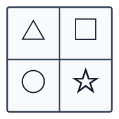

# The SlideScramble Portable Lens

> **Working guide.** This document records the portable lens demonstrated in the author's handwritten diagrams. The base arrangements are established below; directional formulas and the Shuffle Atlas are being transcribed and checked against the original pages before being marked canonical.

## Purpose

SlideScramble moves complete rows or columns cyclically, with wrapping. The *portable lens* is a method for following four distinguished tiles through a localized sequence of full-row and full-column moves. The shapes identify tiles; their assigned coordinates locate them on the board.

The same formulas are intended to work at different board positions when their coordinates and affected row/column indices are translated consistently.

## Symbol and blank-cell convention

| Symbol | Name |
| --- | --- |
| ○ | Circle |
| ☆ | Star |
| △ | Triangle |
| □ | Square |

**An unmarked (blank) cell in a lens diagram means its original cell value. It does not mean an empty position.** SlideScramble has no empty cells.

The symbols represent the four distinguished tiles, not fixed screen positions. To apply a lens, write the four shapes together with the corresponding current cell coordinates and follow the shape-directed formula.

## Given lens


```text
○  ☆
△  □
```

## Column swap


```text
☆  ○
□  △
```

The resulting two-column exchange corresponds to two disjoint swaps among the four distinguished tiles. The original handwritten page also includes a directional formula; **verify its precise arrow sequence against the source before transcribing it here**.

## Row swap



```text
△  □
○  ☆
```

The resulting two-row exchange likewise corresponds to two disjoint swaps. The exact shape-directed formula remains to be transcribed and checked.

## Shuffle Atlas — working index

The second handwritten page organizes **eight examples in a deliberate two-column by two-row grid**, with two examples per quadrant. Preserve that arrangement in the SVG rendering, including arrow direction, symbol identity and original-value blanks.

A provisional readable identifier is `Lens.CircleSquare.A`: the first two named moves followed by the A/B variant. The final names must be verified against the actual directional sequences in the handwritten source.

**Do not infer that the eight examples are eight mathematically independent transformations.** They may describe different entry configurations of the same portable mechanism.

### Intended presentation

- Four paired groups, retaining the handwritten grid structure.
- Each example displays its directional sequence above its resulting 2×2 marked-cell diagram.
- An accessible textual transcription accompanies each SVG.
- Blank cells remain visually blank but are defined as **original values**, never empty.

## Applying the portable lens

1. Choose the four distinguished tile identities.
2. Write the shape-to-current-cell-coordinate bindings.
3. Identify the matching shuffle/entry configuration.
4. Follow the shape-directed moves, using full-row and full-column rotations in SlideScramble.
5. Check the resulting arrangement, including the unchanged/original-value cells.

A shifted, wraparound test board has been recorded with the original `(1,1)` tile at board position `(2,2)`, aligned to the circle in the centered 2×2 lens. This is useful as a reproducible portability test, not proof of mathematical completeness for all possible configurations.

## Related examples

See [the SlideScramble README](SlideScramble.README.md) and [the bundled challenge catalog](challenges.json) for recordings such as `Lens-Column reversal`, `Lens-Row reversal`, and `Lens Parity`. These are useful worked examples for a later article; do not assert they implement a particular named atlas entry without verification.

## Verification and publication checklist

- [x] Preserve the given, column-swap, and row-swap outcomes.
- [x] Define blank-cell notation and shape identities correctly.
- [ ] Transcribe and verify both complete directional formulas.
- [ ] Transcribe all eight Shuffle Atlas entries exactly, including blanks and arrows.
- [ ] Agree on the A/B naming and whether the initial moves alone uniquely identify an entry.
- [ ] Render the atlas as SVG in its original grid arrangement.
- [ ] Compare diagrams with actual SlideScramble recordings and coordinate bindings.
- [ ] Prepare a later JohnCornell.net article from the verified guide.
