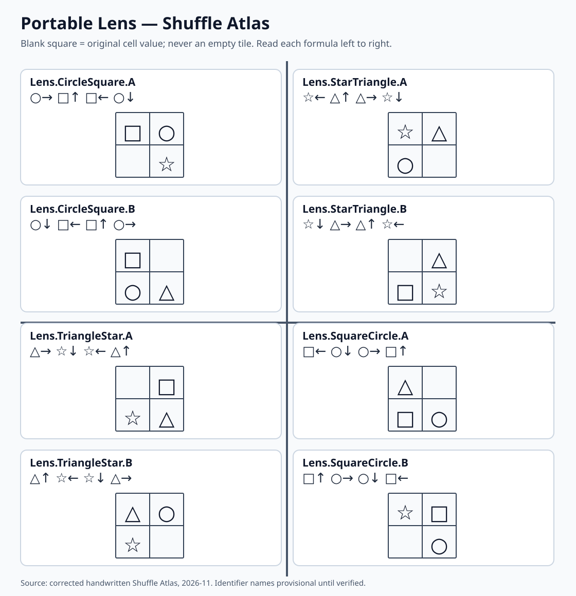

# The SlideScramble Portable Lens

> **Verified working guide.** This document records the portable lens from the author's handwritten diagrams, including the corrected Shuffle Atlas. The 16 transcribed formulas have been checked by executable board simulation; a proof of exhaustive classification is outside the present scope.

## Purpose

SlideScramble moves complete rows or columns cyclically, with wrapping. The *portable lens* is a method for following four distinguished tiles through a localized sequence of full-row and full-column moves. The shapes identify tiles; their assigned coordinates locate them on the board.

The same formulas are intended to work at different board positions when their coordinates and affected row/column indices are translated consistently.

## Symbol and blank-cell convention

| Symbol | Name |
| --- | --- |
| ○ | Circle |
| ☆ | Star |
| △ | Triangle |
| □ | Square |

**An unmarked (blank) cell in a lens diagram means its original cell value. It does not mean an empty position.** SlideScramble has no empty cells.

The symbols represent the four distinguished tiles, not fixed screen positions. To apply a lens, write the four shapes together with the corresponding current cell coordinates and follow the shape-directed formula.

## Given lens


```text
○  ☆
△  □
```

## Column swap — four verified eight-move formulas


```text
☆  ○
□  △
```

The original page lists four named entry orientations. **Each table row below is an entire eight-move formula read left to right**; the numbered columns are successive moves, not simultaneous actions. A direction indicates a **one-cell cyclic rotation of the entire row or column currently containing that marked tile**.

| Orientation on handwritten page | 1 | 2 | 3 | 4 | 5 | 6 | 7 | 8 |
| --- | --- | --- | --- | --- | --- | --- | --- | --- |
| Up left | △↑ | □↑ | □← | □↓ | △→ | △→ | △↓ | ☆← |
| Down left | ○↓ | ☆↓ | ☆← | ☆↑ | ○→ | ○→ | ○↑ | □← |
| Up right | □↑ | △↑ | △→ | △↓ | □← | □← | □↓ | ○→ |
| Down right | ☆↓ | ○↓ | ○→ | ○↑ | ☆← | ☆← | ☆↑ | △→ |

All four formulas were independently replayed on the centered 4×4 wraparound board described below. Each produced the depicted column swap in the 2×2 lens **and restored every other board cell to its starting value**.

## Row swap — four verified eight-move formulas


```text
△  □
○  ☆
```

| Orientation on handwritten page | 1 | 2 | 3 | 4 | 5 | 6 | 7 | 8 |
| --- | --- | --- | --- | --- | --- | --- | --- | --- |
| Left up | ☆← | □← | □↑ | □→ | ☆↓ | ☆↓ | ☆→ | △↑ |
| Left down | □← | ☆← | ☆↓ | ☆→ | □↑ | □↑ | □→ | ○↓ |
| Right up | ○→ | △→ | △↑ | △← | ○↓ | ○↓ | ○← | ☆↑ |
| Right down | △→ | ○→ | ○↓ | ○← | △↑ | △↑ | △← | □↓ |

All four formulas independently produced the depicted row swap in the 2×2 lens and restored all other cells. The row-swap entries are intentionally ordered **Left up, Left down, Right up, Right down**: their initiating symbols (☆, □, ○, △) are the exact reverse of the column-swap entries (△, ○, □, ☆). This is a reversal of the *listed first symbols*, not of the complete move sequences.

### Reading a shape-directed move

For example, `△↑` means: find the current coordinate of the **triangle tile**, then rotate that tile's **entire column upward by one cell**, including every other tile in that column. Resolve the next symbol's current position *after* executing this move.

Repeated instructions such as `△→ △→` are **two one-cell moves**, not a claim that a two-cell rotation counts as two game moves under every input scheme. They preserve the actual order of the handwritten formula.

## Shared structure of the eight-move swaps

The four column-swap formulas and four row-swap formulas are **one repeated instruction pattern with different shape and direction bindings**.

Let `X` and `Y` be the first and second selected shapes, `Z` the final shape, `a` the first direction, and `b` the third direction. The complete eight-instruction pattern is:

```text
X:a   Y:a   Y:b   Y:opposite(a)
X:opposite(b)   X:opposite(b)   X:opposite(a)   Z:b
```

The pattern of **shape references** is `X Y Y Y X X X Z`; the **directions** follow `a a b −a −b −b −a b`. Here `−` denotes the opposite arrow, not a subtraction of tile coordinates.

For example, Column swap / Up left uses `X=△`, `Y=□`, `Z=☆`, `a=↑`, and `b=←`. Substituting those bindings produces its exact eight arrows. The remaining seven rows use the same structure with different bindings. This describes a shared **formula pattern**, not a claim that all eight executions are the same intermediate board state.

The four column-swap variants share one final column-swap result; likewise, the four row-swap variants share one final row-swap result. Rotating or reflecting the choice of the initial shapes and arrows supplies the corresponding entry orientation. Individual intermediate paths still deserve their own documentation.

## Shuffle Atlas — corrected transcription



The corrected handwritten page arranges eight **entry configurations** in a deliberate **two-column, four-row** grid. **The vertical and horizontal separator lines divide four paired groups; this is part of the original organization and should remain visible in derivative illustrations.** The first entry of the upper-right group replaces a crossed-out drawing; the SVG above shows only the corrected diagram. Each direction is the move of the indicated shape, **not an instruction to move just one tile**: SlideScramble still rotates entire rows or columns.

A **blank diagram cell denotes that cell's original value**. No cell is empty.

The labels below are provisional mnemonic identifiers: the first two named shapes, followed by an A or B variant. They do not claim a proven classification of all possible local states.

| Position in page | Working identifier | Shape-directed moves | Marked result (top / bottom) |
| --- | --- | --- | --- |
| Upper left A | `Lens.CircleSquare.A` | ○→, □↑, □←, ○↓ | `□ ○ / · ☆` |
| Upper right A **(corrected)** | `Lens.StarTriangle.A` | ☆←, △↑, △→, ☆↓ | `☆ △ / ○ ·` |
| Upper left B | `Lens.CircleSquare.B` | ○↓, □←, □↑, ○→ | `□ · / ○ △` |
| Upper right B | `Lens.StarTriangle.B` | ☆↓, △→, △↑, ☆← | `· △ / □ ☆` |
| Lower left A | `Lens.TriangleStar.A` | △→, ☆↓, ☆←, △↑ | `· □ / ☆ △` |
| Lower right A | `Lens.SquareCircle.A` | □←, ○↓, ○→, □↑ | `△ · / □ ○` |
| Lower left B | `Lens.TriangleStar.B` | △↑, ☆←, ☆↓, △→ | `△ ○ / ☆ ·` |
| Lower right B | `Lens.SquareCircle.B` | □↑, ○→, ○↓, □← | `☆ □ / · ○` |

The dot (`·`) in the table is a *textual placeholder for the original value at that lens cell*, not a new lens symbol and not an empty tile. **On the centered test board**, the eight marked results each resolve the dot to the corresponding original symbol, meaning all four distinguished tiles remain in place except those explicitly repositioned. The SVG keeps those cells visually blank, matching the handwritten page.

### A/B symmetry: opposite traversal order

Each A/B pair uses the **same ordered shapes** (first–second–second–first) and the **same four arrow directions in reverse order**. For example:

```text
Lens.CircleSquare.A: ○→  □↑  □←  ○↓
Lens.CircleSquare.B: ○↓  □←  □↑  ○→
```

This exact relation holds for `CircleSquare`, `StarTriangle`, `TriangleStar`, and `SquareCircle`, and is checked by the verifier. It makes A and B opposite **directional traversals**, but do **not** conflate it with the inverse of a recorded sequence. Reversing a `SessionRecording` also reverses execution order, negates each move, and updates its drag-start binding; these A/B formulas instead preserve their shape-reference order and exchange the order of directions.

Thus the visual symmetry is real, while the two resulting entry configurations remain distinct. This distinction is useful for choosing an entry pattern during play.

### What the atlas establishes

The corrected page documents four paired groups, each with two orientations. Their organization and separating rules are part of the reference diagram, not decorative formatting. Treat the entries as observed and verified portable configurations. A separate mathematical check would be needed before claiming they exhaust every possible case up to board translation, wrapping, rotation, or reflection.

### Source and diagram fidelity

- The upper-right A entry is taken from the **newly redrawn** diagram rather than the crossed-out one.
- The four arrow steps in each entry are transcribed in displayed left-to-right order.
- The source's **vertical center divider** and **horizontal mid-page divider** are both preserved; together they distinguish four paired groups.
- All 16 transcriptions have now passed the automated centered-board and translated-position checks. A human visual comparison of the SVG against the handwritten source remains worthwhile before publication.

## Reproducible verification on the centered board

The source test recording is a 4×4 board with the four home-coordinate tiles `(1,1)`, `(2,1)`, `(1,2)`, and `(2,2)` aligned to ○, ☆, △, and □ respectively in the central 2×2 lens.

```text
(4,4) (1,4) (2,4) (3,4)
(4,1) (1,1) (2,1) (3,1)
(4,2) (1,2) (2,2) (3,2)
(4,3) (1,3) (2,3) (3,3)
```

The verifier [`verify_portable_lens.py`](verify_portable_lens.py) applies each arrow by locating the selected tile **in the current board**, cyclically rotating the whole indicated row/column by one step, and then checking the board state.

**Verified against the source drawings:**

- All four column-swap formulas: `☆ ○ / □ △` (with other cells restored).
- All four row-swap formulas: `△ □ / ○ ☆` (with other cells restored).
- All eight Shuffle Atlas entries, resolving each visually blank cell to its original value.
- All eight shuffle operations restore every cell *outside the central 2×2 lens* to its original board value.

**Translation and wraparound verification:** The same 16 formulas were also tested at every 2×2 lens placement (including border and corner wrapping) on 3×3, 4×4, 5×5, 5×3, and 7×6 boards. All **1,712 cases** passed: the expected marked-cell result was produced and all cells outside the 2×2 lens returned to their starting identities. This supports geometric portability across the tested placements and dimensions; it does not establish a universal completeness theorem.

Run: `python3 verify_portable_lens.py` (standard library only).

## Applying the portable lens

1. Choose the four distinguished tile identities.
2. Write the shape-to-current-cell-coordinate bindings.
3. Identify the matching shuffle/entry configuration.
4. Follow the shape-directed moves, using full-row and full-column rotations in SlideScramble.
5. Check the resulting arrangement, including the unchanged/original-value cells.

The supplied 4×4 shifted-board fixture puts the original `(1,1)` tile at board position `(2,2)`, aligned to ○ in the centered 2×2 lens. The formulas have also passed the additional board-position checks described above; these tests support portability without proving that the atlas exhausts every possible entry state.

## Related examples

See [the SlideScramble README](SlideScramble.README.md) and [the bundled challenge catalog](challenges.json) for recordings such as `Lens-Column reversal`, `Lens-Row reversal`, and `Lens Parity`. These are useful worked examples for a later article; do not assert they implement a particular named atlas entry without verification.

## Verification and publication checklist

- [x] Preserve the given, column-swap, and row-swap outcomes.
- [x] Define blank-cell notation and shape identities correctly.
- [x] Transcribe and verify all four column-swap and all four row-swap directional formulas.
- [x] Transcribe and verify eight Shuffle Atlas entries from the corrected diagram on the centered 4×4 board; broader completeness remains open.
- [x] Document the provisional A/B naming and verify that each pair shares the same glyph order with reversed arrow order.
- [x] Arrange row-swap entries so their initiating-symbol order exactly reverses the column-swap order.
- [ ] Decide whether to retain the provisional identifier spellings in a published article.
- [x] Render the corrected atlas as SVG in its original grid arrangement.
- [x] Verify all 16 sequences against the centered board's coordinates and the wraparound move convention.
- [x] Test all 16 formulas against every translated placement on five board dimensions, including wraparound boundaries (1,712 successful cases).
- [ ] Independently check mathematical completeness of the entry-pattern classification, if desired.
- [ ] Prepare a later JohnCornell.net article from the verified guide, using the SVGs as canonical figures and highlighting the A/B and swap-pattern symmetries.
