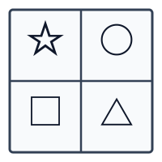
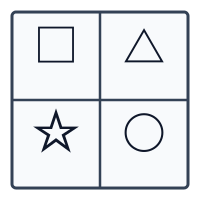

# The SlideScramble Portable Lens

A practical guide to localized tile transformations in SlideScramble, using four shapes to track tiles through wraparound row and column moves. The formulas and Shuffle Atlas have been tested with a reproducible board simulation.

## How the lens works

SlideScramble rotates entire rows or columns cyclically, with wrapping. The *portable lens* follows four distinguished tiles through sequences of these full-line moves to achieve a localized result. Shapes identify tiles; their current positions determine which row or column moves.

The formulas work at different board positions when the lens is relocated and the current positions of its four tiles are tracked.

## Symbol and blank-cell convention

| Symbol | Name |
| --- | --- |
| ○ | Circle |
| ☆ | Star |
| △ | Triangle |
| □ | Square |

**An unmarked (blank) cell in a lens diagram means its original cell value. It does not mean an empty position.** SlideScramble has no empty cells.

The symbols represent the four distinguished tiles, not fixed screen positions. Establish their identities at the beginning of an operation; the arrows then follow those tiles through the board.

### Symbolic operations and the circle anchor

Write `○@(column,row)` to locate a lens by the **initial position of ○**, the upper-left reference cell of the Given 2×2 arrangement. Coordinates are one-based, with the column first. ☆, △, and □ occupy the other three lens positions to the right and below, wrapping around board edges as needed.

```text
ColumnSwap ○@(3,3)          column-swap effect at this lens
ColumnSwap.UpLeft ○@(3,3)   the specific Up left formula
RowSwap.LeftUp ○@(3,3)     the specific Left up formula
Lens.CircleSquare.A ○@(3,3)   the named Shuffle Atlas rotation
```

An **unqualified operation** (`ColumnSwap` or `RowSwap`) names the desired permutation, independent of the four formulas that implement it. Use the qualified name when a specific execution sequence matters. The anchor identifies the *starting binding*, not a permanently fixed tile. After each arrow, find the named tile at its current position. Before applying another complete operation, rebind the Given shapes to the tiles currently occupying the lens positions.

A **formula step** is one unit arrow. A **game move** is one committed row/column rotation (which may move multiple cells). A **lens operation** is the complete local transformation. Their counts need not coincide.

## Four tiles on a wraparound board

Start from the four shapes arranged as a 2×2 lens. **Column swap** exchanges the left/right positions in both rows; **row swap** exchanges the upper/lower positions in both columns. **Both** applies the two swaps together, exchanging each tile with its diagonal partner.

| Given | Column swap |
| :---: | :---: |
|  |  |
| **Row swap** | **Both** |
|  |  |

In shape notation:

```text
Given           Column swap      Row swap         Both
○  ☆            ☆  ○             △  □             □  △
△  □            □  △             ○  ☆             ☆  ○
```

The row and column swaps commute as **transformations of the four lens positions**: either composition produces the same diagonal exchange. Each individual swap is an involution, and applying Both twice returns to Given.

**Applying both formulas in sequence:** each eight-move formula assumes the symbols are assigned to the four lens *positions* in the Given arrangement. Before executing the second formula, assign ○, ☆, △, □ afresh to the tiles currently in the upper-left, upper-right, lower-left, and lower-right cells. These temporary shape labels guide the next sequence; they do not change the tiles' actual identities. Both orders were checked using the full row/column moves, including restoration of the surrounding cells.

## Column swap — four verified eight-step formulas

The operation `ColumnSwap` has four entry orientations. **Read each eight-step formula from left to right**; the numbered columns are successive one-cell formula steps, not simultaneous actions. A direction indicates a **one-cell cyclic rotation of the entire row or column currently containing that marked tile**.

| Identifier (handwritten orientation) | 1 | 2 | 3 | 4 | 5 | 6 | 7 | 8 |
| --- | --- | --- | --- | --- | --- | --- | --- | --- |
| `ColumnSwap.UpLeft` (Up left) | △↑ | □↑ | □← | □↓ | △→ | △→ | △↓ | ☆← |
| `ColumnSwap.DownLeft` (Down left) | ○↓ | ☆↓ | ☆← | ☆↑ | ○→ | ○→ | ○↑ | □← |
| `ColumnSwap.UpRight` (Up right) | □↑ | △↑ | △→ | △↓ | □← | □← | □↓ | ○→ |
| `ColumnSwap.DownRight` (Down right) | ☆↓ | ○↓ | ○→ | ○↑ | ☆← | ☆← | ☆↑ | △→ |

Each formula produces the column swap within the 2×2 lens **while restoring every other board cell to its starting value**.

## Row swap — four verified eight-step formulas

The operation `RowSwap` likewise has four entry orientations.

| Identifier (handwritten orientation) | 1 | 2 | 3 | 4 | 5 | 6 | 7 | 8 |
| --- | --- | --- | --- | --- | --- | --- | --- | --- |
| `RowSwap.LeftUp` (Left up) | ☆← | □← | □↑ | □→ | ☆↓ | ☆↓ | ☆→ | △↑ |
| `RowSwap.LeftDown` (Left down) | □← | ☆← | ☆↓ | ☆→ | □↑ | □↑ | □→ | ○↓ |
| `RowSwap.RightUp` (Right up) | ○→ | △→ | △↑ | △← | ○↓ | ○↓ | ○← | ☆↑ |
| `RowSwap.RightDown` (Right down) | △→ | ○→ | ○↓ | ○← | △↑ | △↑ | △← | □↓ |

Each formula produces the row swap while restoring all other cells. The entries are ordered **Left up, Left down, Right up, Right down** so that their starting symbols (☆, □, ○, △) exactly reverse those of the column swap (△, ○, □, ☆). This symmetry concerns the starting symbols, not the complete move sequences.

### Reading a shape-directed move

For example, `△↑` means: find the current coordinate of the **triangle tile**, then rotate that tile's **entire column upward by one cell**, including every other tile in that column. Resolve the next symbol's current position *after* executing this move.

Repeated instructions such as `△→ △→` are **two one-cell formula steps**, not a claim that a two-cell rotation counts as two committed game moves. They preserve the actual order of the handwritten formula.

## Shared structure of the eight-move swaps

The column-swap and row-swap formulas share **one instruction pattern**, with different shapes and directions.

Let `X` and `Y` be the first and second selected shapes, `Z` the final shape, `a` the first direction, and `b` the third direction. The complete eight-instruction pattern is:

```text
X:a   Y:a   Y:b   Y:opposite(a)
X:opposite(b)   X:opposite(b)   X:opposite(a)   Z:b
```

The pattern of **shape references** is `X Y Y Y X X X Z`; the **directions** follow `a a b −a −b −b −a b`. Here `−` denotes the opposite arrow, not a subtraction of tile coordinates.

For example, `ColumnSwap.UpLeft` uses `X=△`, `Y=□`, `Z=☆`, `a=↑`, and `b=←`. Substituting those bindings produces its exact eight arrows. The remaining seven rows use the same structure with different bindings. This describes a shared **formula pattern**, not a claim that all eight executions are the same intermediate board state.

All four column-swap variants produce the same final arrangement, as do the four row-swap variants. The intermediate paths differ with the chosen starting shapes and directions.

## Shuffle Atlas


The atlas arranges eight **entry configurations** in a **two-column, four-row** grid. Its prominent vertical and horizontal dividers organize four quadrants. **The top half rotates clockwise, and the bottom half rotates counterclockwise.** The unchanged (blank) cells face inward toward the center of each half, while inverse rotations are aligned directly above and below one another. Each arrow refers to the row or column containing the indicated shape, **not a move of that tile alone**.

A **blank diagram cell denotes that cell's original value**. No cell is empty.
To find the inverse shuffle, locate the entry whose **blank** occupies the same cell. With the inverse-aligned naming convention, its identifier has the **same A or B suffix** in the corresponding family directly above or below it.

The identifiers name the first two shapes in the formula and its A/B variant, for example `Lens.CircleSquare.A`. The matching A/B labels on the top and bottom halves identify **inverse 3-cycles aligned vertically**. These names do not imply an exhaustive classification of all possible local states.

| Atlas position | Identifier | Shape-directed moves | Marked result (top / bottom) |
| --- | --- | --- | --- |
| Upper left A | `Lens.TriangleStar.A` | △↑, ☆←, ☆↓, △→ | `△ ○ / ☆ ·` |
| Upper right A | `Lens.CircleSquare.A` | ○→, □↑, □←, ○↓ | `□ ○ / · ☆` |
| Upper left B | `Lens.SquareCircle.B` | □←, ○↓, ○→, □↑ | `△ · / □ ○` |
| Upper right B | `Lens.StarTriangle.B` | ☆↓, △→, △↑, ☆← | `· △ / □ ☆` |
| Lower left A | `Lens.StarTriangle.A` | ☆←, △↑, △→, ☆↓ | `☆ △ / ○ ·` |
| Lower right A | `Lens.SquareCircle.A` | □↑, ○→, ○↓, □← | `☆ □ / · ○` |
| Lower left B | `Lens.CircleSquare.B` | ○↓, □←, □↑, ○→ | `□ · / ○ △` |
| Lower right B | `Lens.TriangleStar.B` | △→, ☆↓, ☆←, △↑ | `· □ / ☆ △` |

The dot (`·`) in the table means the **original value of that cell**. It is not another symbol or an empty space. The SVG leaves those cells visually blank. Each atlas sequence cycles three distinguished tiles while leaving the fourth in its original position.

### Clockwise and counterclockwise rotations

Read the top four shuffles as **clockwise** three-position rotations and the bottom four as **counterclockwise** rotations around their respective fixed cells. Clockwise refers to the order of the three moving positions on the 2×2 lens, **not** to rotating the entire square or to an individual row or column move. For example, `Lens.CircleSquare.A` moves ○ from top left to top right, ☆ from top right to bottom right, and □ from bottom right to top left while △ remains in place. The corresponding inverse, `Lens.SquareCircle.A`, appears immediately below it.

### The shuffle as a three-position rotation

Every Shuffle Atlas entry cycles three positions while preserving the fourth. Applying the same operation three times restores the original arrangement.

A shuffle therefore has a period of three, and applying it twice produces its inverse. The matching-blank entry in the atlas provides that inverse directly, without repeating the original operation. For example, `Lens.CircleSquare.A` is undone by `Lens.SquareCircle.A`, and `Lens.StarTriangle.B` is undone by `Lens.TriangleStar.B` (rebind the shapes to the current lens positions before applying the inverse).

For example, `Lens.CircleSquare.A` rotates the three positions surrounding its fixed bottom-left cell. With shapes rebound by position before each application, three successive executions return the entire board to its starting state.

### Two symmetries: traversal and inversion

Each A/B pair uses the **same ordered shapes** (first–second–second–first) and the **same four arrow directions in reverse order**. For example:

```text
Lens.CircleSquare.A: ○→  □↑  □←  ○↓
Lens.CircleSquare.B: ○↓  □←  □↑  ○→
```

The relation holds for `CircleSquare`, `StarTriangle`, `TriangleStar`, and `SquareCircle`. A and B are opposite **directional traversals**, not inverse recordings. An inverse recording reverses the move order and each move direction, while updating the drag-start position.

Within each named family, A and B retain their opposite directional traversals. **Across top and bottom halves, matching suffixes now indicate vertically aligned inverses**: CircleSquare pairs with SquareCircle, and StarTriangle pairs with TriangleStar. The left-hand entries have been vertically exchanged so each upper entry is clockwise and each lower entry counterclockwise. Every result's blank cell faces the center of its half. The two bold dividers continue to distinguish the four quadrants.

### Scope

The eight atlas entries are tested, portable transformations. Their identifiers are defined by this inverse-aligned naming convention. They are not claimed to exhaust every possible configuration up to symmetry. The dividing lines preserve the four quadrants; the ordering emphasizes clockwise versus counterclockwise rotation, inward-facing fixed cells, and vertical inverse relationships.

## Reproducible verification

The centered test board is a 4×4 arrangement with the four home-coordinate tiles `(1,1)`, `(2,1)`, `(1,2)`, and `(2,2)` aligned to ○, ☆, △, and □ respectively in the central 2×2 lens.

```text
(4,4) (1,4) (2,4) (3,4)
(4,1) (1,1) (2,1) (3,1)
(4,2) (1,2) (2,2) (3,2)
(4,3) (1,3) (2,3) (3,3)
```

The verifier [`verify_portable_lens.py`](verify_portable_lens.py) applies each arrow by locating the selected tile **in the current board**, cyclically rotating the whole indicated row/column by one step, and then checking the board state.

**Verified outcomes:**

- All four column-swap formulas: `☆ ○ / □ △` (with other cells restored).
- All four row-swap formulas: `△ □ / ○ ☆` (with other cells restored).
- All eight Shuffle Atlas entries, resolving each visually blank cell to its original value.
- All eight shuffle operations restore every cell *outside the central 2×2 lens* to its original board value.
- **Both** was checked as Column swap followed by Row swap and in the reverse order, rebinding the shapes by lens position between formulas. Both compositions produce the diagonal exchange; repeating the composition restores Given.

**Portability:** All 16 formulas were tested at every 2×2 lens placement, including wraparound boundaries, on 3×3, 4×4, 5×5, 5×3, and 7×6 boards. All **1,712 cases** passed, with the expected result inside the lens and every surrounding tile restored. This is test evidence for portability across those boards, not proof that the atlas is mathematically exhaustive.

Run: `python3 verify_portable_lens.py` (standard library only).

## Applying the portable lens

1. Establish the lens position with a circle anchor such as `○@(3,3)` (column, row).
2. Bind the four shapes to the tile identities currently occupying the Given lens positions.
3. Select the transformation, for instance `ColumnSwap`, or the qualified variant `ColumnSwap.UpLeft` if a particular formula is required.
4. Execute the shape-directed formula steps, finding each tile's current row or column after the preceding step.
5. Check the resulting arrangement, including unchanged/original-value cells. Rebind the shapes before another complete operation.

In the centered board, `○@(2,2)` establishes the lens in the middle. The tile labeled `(1,1)` initially occupies that circle anchor. The same shape-to-tile technique works when the 2×2 lens moves elsewhere on the board.

## Centered challenge and related examples

The bundled [`Centered` challenge](challenges.json) uses the shifted 4×4 layout shown in this guide and includes **eight recorded alignment moves**. It is a convenient starting board for lens experiments and a demonstration of how to restore the solved arrangement.

See [the SlideScramble README](SlideScramble.README.md) and [the challenge catalog](challenges.json) for further examples, including `Lens-Column reversal`, `Lens-Row reversal`, and `Lens Parity`.

## From the Author

I developed the Portable Lens through playing SlideScramble and working through the transformations on graph paper. Following four shapes made it easier to see how full-row and full-column moves could produce a local result while restoring the surrounding board. The formulas became a practical reference, and the later software checks helped verify that the method travels with the lens.

The [illustrated Portable Lens article on JohnCornell.net](https://johncornell.net/the-slidescramble-portable-lens-local-moves-in-a-wraparound-puzzle) tells the story behind the diagrams. This guide keeps the formulas, notation, and verification close to the [SlideScramble source](SlideScramble.README.md).
