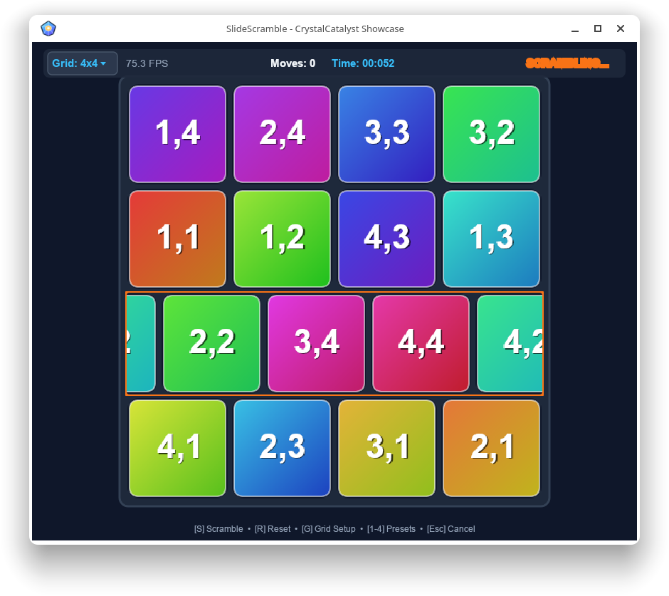

# SlideScramble

**SlideScramble** is a wraparound row-and-column puzzle built as a showcase application for **CrystalCatalyst**.

Unlike the traditional missing-tile sliding puzzle, SlideScramble has no empty space.

Instead, the player may grab an entire row or column and slide it in either direction. Tiles wrap around the opposite edge of the board, allowing every move to transform the puzzle while preserving the complete grid.

<p align="center">
  
</p>

For a documented technique for manipulating small groups of tiles, see the [Portable Lens Guide](PortableLens.md), including the verified swap formulas and Shuffle Atlas diagrams.

## The Puzzle

Each tile has a home coordinate.

The goal is simple:

> Return every tile to its original position.

The mechanism is equally simple:

- drag a row left or right;
- drag a column up or down;
- movement wraps continuously around the grid;
- release to commit the move.

From those rules comes a surprisingly rich puzzle.

A single move affects an entire line of tiles, and fixing one relationship may disturb another. The player therefore works with the structure of the board rather than moving isolated pieces.

## Build Your Own Puzzle

SlideScramble is not limited to a single board size.

The grid can be configured independently in each dimension, making boards such as:

```text
2 x 4
3 x 3
3 x 5
4 x 4
5 x 7
9 x 9
```

possible from the same game.

This changes more than the amount of work required.

A narrow rectangular board behaves differently from a square one. Row and column cycles interact differently, visual strategies change, and patterns that are useful on one geometry may be much less useful on another.

For that reason, grid dimensions act almost like **puzzle parameters or levels**.

SlideScramble can therefore be thought of not only as one puzzle, but as a small generator for a family of related puzzles.

## Command menu

Press **Space** to open the centered command menu. Use **Up** and **Down** to
highlight a command, then **Enter** to run it. You can also click an entry or
press its listed shortcut while the menu is open. Running a command closes the
menu first. Press **Space** again or **Esc** to close it without running a command.

| Command | Shortcut | What it does |
| --- | --- | --- |
| **Edit Board** | | Opens the board editor. It is the first entry, so **Space**, then **Enter**, opens it. |
| **Scramble** | **S** | Mixes the board with legal row and column moves. |
| **Generate Challenge** | | Starts from solved, then scrambles and keeps a replayable solution. |
| **Reset Board** | **X** | Returns the current grid to its solved arrangement. |
| **Grid Setup** | **G** | Opens the column and row controls. Set each dimension independently from 2 to 9. |
| **3 × 3**, **4 × 4**, **6 × 6**, **8 × 8 Grid** | **1**, **2**, **3**, **4** | Switches to the corresponding square grid. |
| **Session Controls** | **R** | Shows or hides the recording and playback panel. |
| **Challenges** | **C** | Opens the challenge picker and board preview. |
| **Time Reversal** | **Ctrl+Shift+R** | Opens the reversed recording for inspection, starting from the original recording's final board. |
| **Close Menu** | **Space** or **Esc** | Returns to the board. |

During play, drag a row or column and release to commit a move.
**Esc** cancels an active drag or closes Grid Setup or Session Controls.

## Board editor

Open **Edit Board** from the command menu to create a draft of the current
layout. Select a tile, then select another tile to swap the pair. Select the
highlighted tile again to clear the selection. Use **Undo** to reverse the last
swap. Stop any active recording and let the current move or scramble finish
before editing.

| Editor action | Effect |
| --- | --- |
| **Commit & Play** | Uses the draft as the starting board for a fresh run. The timer, move count, goal, and in-memory recording and playback state reset. |
| **Cancel** or **Esc** | Discards the draft and resumes the previous run. The timer excludes the time spent editing. |
| **Save Challenge** | Saves the current draft as a named starting board with zero recorded moves. You can keep editing, commit, or cancel afterward. The saved challenge remains available in the picker. |

An editor swap changes the starting layout. It does not count as a game move
or appear in a replay. To record a solution from an edited layout, choose
**Commit & Play**, then start recording before making the first game move.
A draft can be saved or played without a known solution.

## Challenge catalog

The picker lists both bundled challenges and boards saved with **Save Challenge**.
Editor saves are separate JSON files in `user-challenges/` beside the executable.
Rebuilding the bundled catalog leaves those files alone. Keep a copy of
`user-challenges/` before deleting or replacing the entire build output directory.

`challenges.json` is a JSON object keyed by challenge names, with session recordings
as values. The bundled file is
copied to the build and publish output; `ChallengeCatalog.LoadBundled()` reads it from
`AppContext.BaseDirectory`, not from the current working directory or `sessions`.
To add a challenge, add a named recording to the source file and rebuild or republish, or edit
the deployed app-base copy. For example, this complete catalog swaps the two bottom-right
tiles of a 4×4 board:

```json
{
  "Bottom-right swap": {
    "format": "SlideScramble",
    "version": 2,
    "width": 4,
    "height": 4,
    "initialCells": [
      [[1, 1], [2, 1], [3, 1], [4, 1]],
      [[1, 2], [2, 2], [3, 2], [4, 2]],
      [[1, 3], [2, 3], [3, 3], [4, 4]],
      [[1, 4], [2, 4], [3, 4], [4, 3]]
    ],
    "moves": []
  }
}
```

Each board is a rectangular permutation of its home coordinates; version 2 coordinates
are one-based. An empty `moves` array is valid: the initial arrangement alone describes
the challenge and there are no recorded moves to replay. Nonempty moves use the session
format below. Names must be nonblank and are case-sensitive. Invalid entries are skipped;
a missing, unreadable, malformed, or non-object catalog produces an empty catalog. The recording parser accepts version 1 and
2 and dimensions up to 256, but the current session-loading UI limits each dimension to
2–9; use 2–9 for challenges intended for the game.

Press **C** to open the challenge picker. Selecting a challenge previews it without
changing the board. **Load** starts play from its initial arrangement, while **Moves**
opens its recorded sequence for inspection. A zero-move challenge has no steps to inspect.
Use **Tab** or **Shift+Tab** to move between the editor and enabled actions, and **Enter**
to activate the focused action.
Only one selector can be open at a time. Stop recording and finish any board motion or
grid setup before opening it; existing playback pauses while the selector is open.

The preview and game HUD show **Goal** as the first move count at which the recorded
sequence reaches the solved board. `0` means the starting board is already solved.
If the recording does not establish a solution, the preview shows `?` and the HUD omits
the goal; this does not mean the puzzle is unsolvable.
The goal is a benchmark, not necessarily an optimal solution, and stays fixed during
manual moves. Reset, grid changes, scrambling, and committing an edited board clear it. Playback separately shows
recorded moves remaining, even when the sequence does not solve the board.

## Session recording and playback

Press **R** to show or hide the translucent session panel in the largest available gutter.
It may overlap the board when space is limited. Click the filename field to edit it;
Enter accepts and Escape restores the previous name. While it has focus, game shortcuts
are suppressed. Click **Rec** to capture the current arrangement, play normally, then
click **Stop Rec**. The recording is immediately available for inspection at its final
move. **Save** writes it to a file. **Load** opens the session selector. Its **Load**
starts a playable board and **Moves** opens recorded steps. **|<**, **<**,
and **>** reset, step backward, and step forward. **Play/Pause** advances automatically;
steps animate and highlight the original drag-start cell until the transition finishes.
During manual play, the drag-start cell is highlighted through the release or cancel snap.
**Stop** leaves inspection and
preserves the session for resuming.

**Continue a recording from the current index:** Open a saved session or challenge
through **Moves**, then step to the position where you want to change the solution.
In the Session Controls panel, click **Continue**. A centered confirmation popup
shows the number of moves to retain and how many later moves would be discarded.
Click **Confirm** (or press Enter) to keep exactly the moves already played,
crop the remaining suffix from the *working* recording, and immediately start
recording additional moves from the board now on screen. **Cancel** (or Esc)
returns to inspection without changing the recording.
Use the ordinary board drag controls, then click **Stop Rec** and **Save**.
The newly recorded session retains its original starting board and the selected
prefix; the new moves are appended after that prefix. The visible move count
begins at the selected playback index. The original file is not modified until
you explicitly save, and Save under the same name overwrites that file. Use
a different filename to preserve both versions. The session-panel button remains **Continue**; confirmation happens only in the popup.

**Move numbering:** The recording HUD reports completed moves. When it shows
`Move 5`, the next committed rotation becomes move 6. During inspection,
position 5 is the state *after* five saved moves. Continuing at position 5
preserves moves 1–5 and replaces moves 6 onward.

Recording,
loading, and playback wait until the current drag, snap, or scramble finishes. Reset,
scramble, and grid changes are unavailable while recording or inspecting.

A loaded session can be reversed in play mode by using **Time Reversal** **Ctrl+Shift+R** This offers an easy way to create challenge. Starting from board identity, Record, slide, Stop record, Reverse. And identity becomes the final move. Save if desired.

**To save a board for loading later**, click **Rec**, then **Stop Rec** without
moving any tiles. Enter a filename and click **Save**. The empty recording keeps
the exact starting layout. Open it through **Session Controls → Load**, then
choose **Load** in the picker. **Moves** is unavailable because there are zero steps.

Files are stored as `.json` in the `sessions` directory next to the executable. Names
cannot contain paths or reserved filename characters. Saving under an existing name
replaces that file. The session panel shows status and errors.
Loading validates the file before replacing the current board. Playback does not add
game moves or record itself.

New recordings use version 2, with one-based coordinates matching the tile labels:
columns run left to right and rows top to bottom. Each initial cell is the tile's home
`[x,y]` coordinate. A move's `dragStart` is also `[x,y]`, and `index` is the one-based
row or column selected there. `delta` is unchanged: positive values follow the grid's
logical rotation convention (tiles move left for rows and up for columns).
Version 1 recordings use zero-based coordinates and indices and remain readable; saving
one again writes version 2. Older versions of the application cannot read version 2.

```json
{"format":"SlideScramble","version":2,"width":2,"height":2,
 "initialCells":[[[1,1],[2,1]],[[1,2],[2,2]]],
 "moves":[{"axis":"Row","index":2,"dragStart":[1,2],"delta":1}]}
```

`Grid` owns the rotations; `SessionRecording` validates and serializes the starting
arrangement and moves; `SessionRecordingController` manages recording and inspection.
`ICrystal`, `CrystalInteraction`, and `CrystalTextEditor` provide renderer-independent
input and editing models. The reusable `CrystalCommandMenu` implements
`ICrystalSkia` and uses `CrystalPopupHost` for modal input and focus.

The window binding currently exposes named keys, not committed Unicode text or IME
events. The reusable editor accepts Unicode text from hosts with such an input source,
but this window's filename entry is limited to printable ASCII key events and does not
support IME, clipboard, or complex text shaping. Long filenames are clipped. Font files
are tried in platform-specific order, with the Skia default as fallback.

## Scrambling

Starting a game performs a sequence of legal row and column transformations.

Because the scrambled state is produced through the same operations available to the player, the resulting puzzle remains reachable through normal play.

The move counter begins when the scramble is complete.

### Generate Challenge

Open **Generate Challenge** from the Space menu and choose **1–10** with the
slider or **Left** and **Right**. **1** uses the same number of slides as one
ordinary scramble, and **3** uses three times that number. Click **Generate** or
press **Enter** to start from the solved grid at the current dimensions.

When the shuffle ends, play from the generated layout with zero player moves.
The goal is the first solved position in the reversed scramble recording. Open
**Session Controls** to replay that solution or **Save** it under a filename of
your choice. Generation creates no file on its own.

## Audio

SlideScramble uses **CrystalOpenAL** for lightweight game audio.

Sound is deliberately restrained and serves primarily as interaction feedback rather than as a continuous soundtrack.

The application also exercises the managed CrystalOpenAL infrastructure, including `AudioEngine`, synthesized PCM effects, and the pointerless OpenAL bridge layer.

## CrystalCatalyst Showcase

SlideScramble was created both as a game and as a practical consumer of the CrystalCatalyst libraries.

It exercises several parts of the platform together:

- CrystalCatalyst window creation and input;
- CrystalSkia rendering;
- pointer-driven interaction;
- responsive layout;
- HUD controls;
- game-state management;
- CrystalOpenAL audio;
- managed/native bridge infrastructure.

It is intentionally a complete interactive program rather than an isolated API test.

## Design

The program keeps the puzzle model separate from presentation where practical.

The core concepts include:

```text
Tile
    remembers its home coordinate

Grid
    owns the current tile arrangement
    performs row and column transformations

GameState
    tracks Ready, Scrambling, InGame, and completion state

Window
    handles presentation, input, animation, HUD, and integration
```

This makes the grid mechanics independently understandable and testable while allowing the showcase application to remain visually rich.

## Why Wraparound?

Wraparound movement removes the special empty-cell state of a conventional sliding puzzle.

Every row and every column is always available.

This creates a different kind of reasoning problem.

Instead of asking:

> Which tile can move into the empty space?

the player asks:

> Which cyclic transformation improves the relationships among several tiles at once?

The resulting puzzle is spatial, but it also has an algebraic flavor: every move is a reversible permutation of one row or column.

## Reversibility

Every legal SlideScramble move has an immediate inverse.

Moving a row one position to the right can be undone by moving it one position to the left. The same is true for columns and for larger shifts.

This gives the game a useful property:

**the puzzle changes through reversible transformations rather than destructive state changes.**

That makes experimentation natural. A player can try a move, observe its effect, and reason backward when necessary.

## Difficulty Is More Than Size

Larger boards generally provide more relationships to manage, but board area is not the only source of difficulty.

Geometry matters.

For example:

```text
2 x 4
```

and

```text
4 x 2
```

contain the same number of tiles, yet emphasize different row and column structures.

Likewise, a long narrow grid may encourage very different strategies from a compact square grid.

Future experimentation may reveal useful categories of board geometry, move efficiency, or characteristic solving strategies.

## Development Status

SlideScramble is an active CrystalCatalyst showcase and experimental puzzle.

Current work has focused on:

- polished row and column dragging;
- wraparound animation;
- configurable grid dimensions;
- presets and an in-window command menu;
- draft board editing and local challenge saves;
- responsive fitting of different board geometries;
- restrained game audio;
- CrystalOpenAL integration;
- automated tests around puzzle and audio infrastructure.

The game is intentionally being allowed to develop through play as well as implementation.

## Project Location

```text
Project/CrystalCatalystLibrary.net/SlideScramble
```

The accompanying source is intended to remain readable as a practical CrystalCatalyst application example.