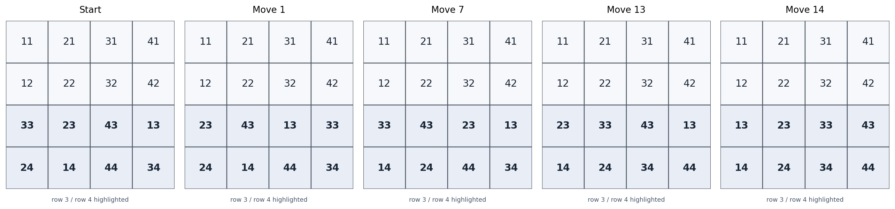
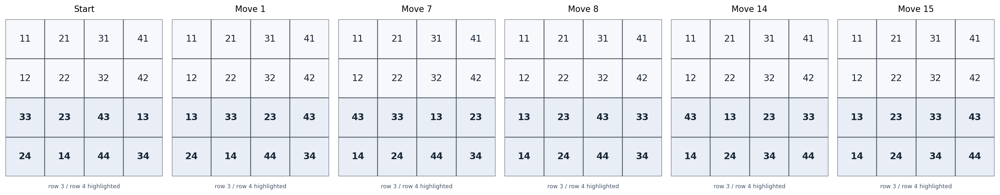

# Spending Swaps: Reasoning Through Lens Parity in SlideScramble

> A worked solving analysis using the Portable Lens **column swap**. The row-level state projections are an exact enumeration under a specified cost measure; the two complete-game solutions are supported by saved recordings. This is a study of a constructive strategy, **not a claim that 14 is the absolute shortest possible game score**.

## The problem: spend a useful exchange, not a wasted one

The *Lens Parity* challenge starts with the first two rows solved. Its remaining rows are:

```text
Row 3: 33  23  43  13
Row 4: 24  14  44  34
```

Each label is a tile's home coordinate `(column,row)`. For the projection tables, we'll abbreviate the rows to `3241` and `2143` respectively, since the row identity is understood.

The question is **not** merely how to fix row 3. It is which correction to choose so that the *column-swap lens* can improve row 3 **and** spend a necessary exchange on row 4. Choosing a good first exchange may save a whole subsequent lens operation.

## Vocabulary and the cost measure

| Term | Meaning here |
| --- | --- |
| **Game move** | One committed whole-row or whole-column SlideScramble rotation. A two-cell drag still counts as **one move**. |
| **Formula step** | One arrow in a shape-directed lens formula: a one-cell rotation of the indicated tile's current row or column. |
| **Column-swap operation** | A complete [portable-lens]([portable-lens](https://github.com/johnwaynecornell/CrystalCatalystLibrary/blob/main/Project/CrystalCatalystLibrary.net/SlideScramble/PortableLens.md)) transformation that exchanges the two horizontal neighbors in each of two neighboring rows, restoring surrounding tiles. It is **not one game move**. |
| **Adjacent pair exchange** | A *projected* swap of entries at columns `1–2`, `2–3`, `3–4`, or `4–1` around the wraparound row. This is our planning unit, not automatically a legal standalone game move. |
| **Cyclic order** | An ordering equivalent to `1234` by rotating the row: `1234`, `2341`, `3412`, or `4123`. |
| **Correction count** | The fewest *adjacent pair exchanges* required to reach **any** of those four cyclic orders; final alignment is counted separately. |
| **Alignment / rectification** | A whole-row rotation after correct cyclic order has been achieved, placing the tiles in their exact home positions. It counts as a game move when executed. |
| **Kink** | An exchange choice that leaves a more expensive correction path than an available alternative, under this row-level measure. This is the author's practical terminology, not an assertion about global optimality. |

We deliberately use **one-exchange**, **two-exchange**, and **three-exchange states**, rather than unqualified *odd* or *even parity*. Ordinary permutation parity is a different mathematical property. When we say a route uses two exchanges, we are counting projected adjacent pair exchanges to cyclic order—not two whole-line moves or two completed lens formulas.

**Counting convention:** swap neighboring positions on the cyclic four-cell ring, then take the shortest number of further such swaps to reach one of the four cyclic goal states. The tables below enumerate **all four possible first exchanges**. This count can be checked by a small breadth-first traversal of the 24 four-tile permutations; it is exact for this restricted row-level model.

## Project row 3 before making a move

Start with **`3241`** (`33 23 43 13`). Consider every possible first adjacent exchange:

| First adjacent exchange | Projected row | Exchanges remaining | Total exchanges | Example follow-up |
| --- | --- | ---: | ---: | --- |
| Columns 1–2 | `2341` | 0 | **1** | Already cyclic |
| Columns 2–3 | `3421` | 1 | **2** | 3–4 |
| Columns 3–4 | `3214` | 2 | **3** | 1–2, 3–4 |
| Columns 4–1 (wrap) | `1243` | 1 | **2** | 3–4 |

Read these outcomes as **projections**; the table does not instruct you to perform four different operations in the game.

The first exchange (columns **1–2**) immediately gives `2341`, which is cyclically correct. This is the one-exchange route. Columns **2–3** produce `3421`, and a second exchange of **3–4** gives `3412`, also cyclically correct. The wraparound exchange **4–1** produces `1243`, and swapping **3–4** gives `1234`.

Columns **3–4** are the **kink** under this cost measure: `3214` requires *two more* adjacent exchanges, for a total of three, versus the one- and two-exchange alternatives. This is a concrete example of a move worth rejecting *before* spending it.

**Key result for row 3:** the projected counts are **1, 2, 3, 2** for columns **1 through 4**. The **2–3** and **4–1** choices are equivalent in this correction count, although they produce different intermediate states and may interact differently with row 4.

## Project row 4 with the same rules

Start with **`2143`** (`24 14 44 34`). Again, enumerate all four possible first adjacent exchanges:

| First adjacent exchange | Projected row | Exchanges remaining | Total exchanges | Example follow-up |
| --- | --- | ---: | ---: | --- |
| Columns 1–2 | `1243` | 1 | **2** | 3–4 |
| Columns 2–3 | `2413` | 1 | **2** | 4–1 |
| Columns 3–4 | `2134` | 1 | **2** | 1–2 |
| Columns 4–1 (wrap) | `3142` | 1 | **2** | 2–3 |

Here the result is striking: **every first exchange leaves one further adjacent exchange to reach cyclic order**. Row 4 therefore has correction count **two**, not one, if we restrict ourselves to exchanges between neighboring columns, including wraparound. The two visible reversed pairs are not themselves a complete strategy; *which* exchanges we choose matters because the column-swap lens must operate on both rows at once.

This distinction corrects an ambiguity in an earlier draft: one can solve `2143` with a single **nonadjacent** exchange (for example positions 1 and 3), but that is **not** an elementary exchange available through a neighboring-column lens. We do not use unrestricted swaps for these projections.

## The key decision: match the exchange counts

A **column-swap lens operation exchanges one adjacent pair in each of two neighboring rows**. It spends one exchange from each row's correction plan at the same time. The projections therefore become much more informative when we read them *together*:

| Candidate first exchange for row 3 | Row 3 total exchanges | Row 4 total exchanges | Planning consequence |
| --- | ---: | ---: | --- |
| Columns 1–2 | **1** | **2** | Row 3 finishes early; another paired exchange still affects it and must be managed. |
| Columns 2–3 | **2** | **2** | **Matching budgets:** two coordinated lens operations could correct both rows. |
| Columns 3–4 | **3** | **2** | A **kink**: one extra row-3 exchange beyond row 4's budget. |
| Columns 4–1 (wrap) | **2** | **2** | **Matching budgets:** another candidate for two coordinated lens operations. |

**Here is the selection rule:** when a lens operation affects two rows simultaneously, look for correction routes with **equal total exchange counts**. In this puzzle, the two-exchange choices for row 3 (columns **2–3** or **4–1**) match row 4's two-exchange requirement. That is why choosing row 3's apparently simpler **one-exchange** route can be less convenient for the *combined* puzzle.


**Exchange budget:** is the number of projected adjacent pair exchanges needed to bring a row into cyclic order, **before** any final alignment. A matched budget is a **planning opportunity**, not a guarantee of an immediately executable move sequence: each selected pair must also be reachable in the same two-column lens at the same time. Row rotations may be needed to bring the chosen pairs into register.

### From the counts to the actual game moves

1. **Count both rows first.** Row 3 offers totals **1, 2, 3, 2**; row 4 offers **2, 2, 2, 2**. The candidate totals **2 and 2** match.
2. **Choose a compatible pair of two-exchange routes.** The row-3 choices starting at columns **2–3** and **4–1** are equivalent by *exchange count*, but not necessarily by the row alignment they require. Inspect row 4's candidate paths and select a pairing that can be realized by the same lens placements.
3. **Establish the first lens position.** Rotate the working row if necessary. This is an actual **game move**, not an abstract exchange.
4. **Execute the first coordinated column-swap construction.** Both rows receive a useful adjacent exchange. Their intermediate orders need not yet be cyclically correct.
5. **Align the next matching pairs and execute the second construction.** When possible, the first construction's ending alignment already supports the second, saving a game move.
6. **Rectify any remaining cyclic offset.** Correct cyclic order may still require a final whole-row rotation to put every tile at its exact home position. That rotation belongs in the recorded score.

The **14-move recording** demonstrates how the selected exchange budgets can be made to cooperate. At move 13, row 4 is solved and row 3 is cyclically ordered; move 14 performs the final rectification. The **15-move recording** reaches the same goal with an additional intermediate alignment. Thus equal exchange counts explain *which plan to investigate*, while the recordings show *how its placements and alignments affect the game-move score*.

Matching budgets should not be confused with minimum total moves. A state with a larger row-level correction count is not automatically a worse whole-board state: alignments, available lens placements, and interaction between rows affect the implementation cost. The projections are a disciplined way to choose a constructive strategy, not a substitute for tracing the legal moves.

## Generalizing the method

The reasoning is not limited to a 4×4 board. For a board with an **even number of columns greater than two**, treat each row as a cyclic sequence. Enumerate candidate adjacent exchanges—including the wraparound pair connecting the last and first columns—and estimate the exchanges remaining to a correctly cyclically ordered row. Where two neighboring rows offer **matching correction budgets**, look for aligned column-swap lens operations that spend one required exchange in each row.

The method also works **perpendicularly**: on a board with an **even number of rows greater than two**, analyze two neighboring *columns* and use **row-swap** lens operations to pair their vertical adjacent exchanges. As before, count the final whole-column alignment separately.

**Scope:** even-length rows and columns are a useful setting for this planning argument, but the portable lens itself also works on odd-sized boards. For larger boards, finding equal counts does not by itself prove that the corresponding exchange sequences can share the same lens placements or that the resulting solution minimizes the number of game moves. The remaining alignment and compatibility decisions are part of the strategy.

## First recorded demonstration: 14 game moves



| Point | Row 3 | Row 4 |
| --- | --- | --- |
| Start | `33 23 43 13` | `24 14 44 34` |
| After move 1 | `23 43 13 33` | `24 14 44 34` |
| After move 7 | `33 43 23 13` | `14 24 44 34` |
| After move 13 | `23 33 43 13` | `14 24 34 44` |
| After move 14 | `13 23 33 43` | `14 24 34 44` |

The recording can be understood in five stages:

1. **Move 1 — establish the working alignment.** Row 3 rotates left one cell. That places the next selected lens area where it can be used in the planned correction.
2. **Moves 2–7 — first coordinated correction block.** The first recorded group leaves row 4 as `14 24 44 34` and row 3 as `33 43 23 13`. Both have useful remaining work; neither has to be solved exactly yet.
3. **Moves 8–13 — second coordinated correction block.** After this group, row 4 is completely solved, while row 3 is `23 33 43 13`: **correct cyclic order**, but not yet aligned to home positions.
4. **Move 14 — final rectification.** Rotate row 3 one cell **right**, transforming `23 33 43 13` into `13 23 33 43`. The entire board is solved.

**Why the rectification matters:** the state at move 13 is *not* a completed solution. A correct cyclic order is a useful planning milestone, but the final whole-row alignment is a **real game move** and belongs in the score. This construction solves the puzzle in **14 committed moves**, one fewer than the earlier 15-move reference challenge.

The groups are presented as parts of one recorded construction, **not** as independently verified six-move implementations of the generic eight-step column-swap formula. The initial alignment and move batching are integral to this specific solution. The full recording is preserved as [`Project/CrystalCatalystLibrary.net/SlideScramble/lens_parity_article/lens-parity-14.json`](lens-parity-14.json). It can be copied into sessions in the binary directory for load.

## Second recorded demonstration: 15 game moves



| Point | Row 3 | Row 4 |
| --- | --- | --- |
| Start | `33 23 43 13` | `24 14 44 34` |
| After move 1 | `13 33 23 43` | `24 14 44 34` |
| After move 7 | `43 33 13 23` | `14 24 44 34` |
| After move 8 | `13 23 43 33` | `14 24 44 34` |
| After move 14 | `43 13 23 33` | `14 24 34 44` |
| After move 15 | `13 23 33 43` | `14 24 34 44` |

This route uses an additional intermediate row alignment:

1. **Move 1:** rotate row 3 right one cell to begin with a different working alignment.
2. **Moves 2–7:** perform the first correction block. Row 4 becomes `14 24 44 34`.
3. **Move 8:** rotate row 3 by two cells to position the second correction.
4. **Moves 9–14:** perform the second correction block. Row 4 is solved, and row 3 has correct cyclic order as `43 13 23 33`.
5. **Move 15:** rotate row 3 left one cell to rectify its exact position, solving the board.

The extra realignment is visible and counted. Thus the 15-move trace is not a worse explanation just because it scores one move more: it shows how the choice of working offset affects implementation cost while retaining the same broad strategy.

The full recording is [`Project/CrystalCatalystLibrary.net/SlideScramble/lens_parity_article/lens-parity-15.json`](lens-parity-15.json).

## The reasoning to take into the next puzzle

The most reusable insight is the **project, match, then commit** method:

1. **Identify cyclic order, not exact alignment, as the first target.** A final rotation can rectify a row cheaply.
2. **Enumerate the four adjacent exchanges** available around a four-cell wraparound row. Project the resulting order and count the remaining correction exchanges.
3. **Identify the kinks**—choices that increase the remaining count without a compensating benefit elsewhere.
4. **Match the correction budgets.** Prefer candidate paths that require an equal number of exchanges in the two rows, so each lens operation can contribute to both. Then verify the required pairs can be aligned in the same lens.
5. **Plan and count alignments.** Establishing a lens position and rectifying the last cyclic offset are committed game moves, even though they are not abstract pair exchanges.
6. **Check the recorded board after each correction block.** The point is not merely to reach a low number in the projection table but to construct a legal, reproducible game solution.

The projection tables are exhaustive *within their restricted adjacent-exchange model*. The paired-budget selection explains why **2 + 2** is a useful plan for this particular board. The recordings demonstrate **14- and 15-move solutions**. Neither fact claims that all possible sequences of full-row and full-column SlideScramble rotations have been searched, or that 14 is globally optimal.

## Recorded moves and reproducibility

The source files retain each move's axis, line, signed offset, and drag-start position. The tables below omit drag-start coordinates for readability; the JSON is authoritative for replay.

<details>
<summary>14-game-move recording</summary>

| Move | Line | Delta |
| ---: | --- | ---: |
| 1 | Row 3 | +1 |
| 2 | Column 2 | +1 |
| 3 | Column 1 | +1 |
| 4 | Row 3 | +1 |
| 5 | Column 1 | -1 |
| 6 | Row 3 | -2 |
| 7 | Column 2 | -1 |
| 8 | Column 3 | +1 |
| 9 | Column 4 | +1 |
| 10 | Row 3 | +1 |
| 11 | Column 3 | -1 |
| 12 | Row 3 | -2 |
| 13 | Column 4 | -1 |
| 14 | Row 3 | -1 |

</details>

<details>
<summary>15-game-move recording</summary>

| Move | Line | Delta |
| ---: | --- | ---: |
| 1 | Row 3 | -1 |
| 2 | Column 2 | +1 |
| 3 | Column 1 | +1 |
| 4 | Row 3 | +1 |
| 5 | Column 1 | -1 |
| 6 | Row 3 | -2 |
| 7 | Column 2 | -1 |
| 8 | Row 3 | +2 |
| 9 | Column 3 | +1 |
| 10 | Column 4 | +1 |
| 11 | Row 3 | +1 |
| 12 | Column 3 | -1 |
| 13 | Row 3 | -2 |
| 14 | Column 4 | -1 |
| 15 | Row 3 | +1 |

</details>

---

*The projected exchange counts were checked against all four cyclic targets using adjacent swaps on a four-position ring. The matching-budget criterion is a constructive heuristic whose placement and alignment requirements remain explicit. The recorded board states and saved move totals were checked by replaying the attached JSON sessions. The strategy and the term “kink” preserve the author's observations and intended interpretation.*
